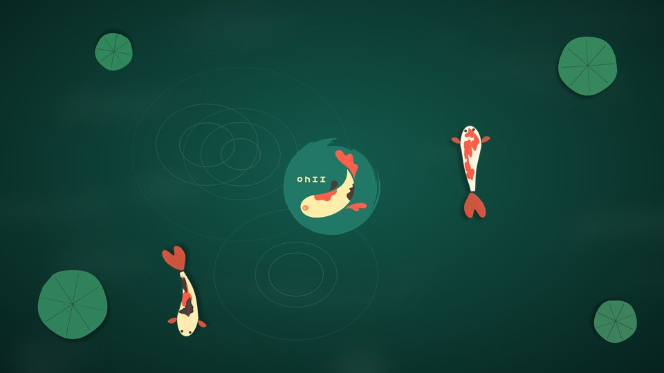

# OweeKoi

Tema para **KDE Plasma 6**: estilo oscuro tipo macOS, kois, un **protector de pantalla animado**
y ajustes de energía y rendimiento para **portátiles y PCs**. Se instala con un solo comando
y se puede deshacer.


## OweeKoi 2 — tinta y papel (rama `v2`)

La versión 2 es **100 % propia**: no usa ni descarga WhiteSur. Un solo rasgo la define: **la onda del
estanque**.

- **Tinta y papel**: modo oscuro (negro pastel cálido con texto crema) y modo claro (papel crema), con
  contraste AA, sin blanco ni negro puros.
- **Doble línea de onda** en ventanas y menús, y un halo de tres anillos finísimos en lugar de una sombra pesada.
- **Ventanas «Onda»**: botones en forma de escama de koi, en pastel (coral, ámbar, verde), con anillo de onda al pasar el ratón.
- **Carpetas de colores** mate y sin brillo, y un menú en Dolphin (*Actions ▸ Color de carpeta*) para marcar las tuyas.
- **Fondos del estanque** con par claro/oscuro y **protector animado** de kois que sigue el modo.
- **Estilo de controles** (`owee-estilo`, opcional): botones en cápsula, campos y listas redondeados y un tinte verde pastel al pasar el ratón. Usa *Union*, el motor de estilos nuevo de KDE (aún «en desarrollo» en Plasma 6.8): `owee-estilo probar` lo abre en un solo programa; `activar`/`desactivar` lo cambian en todo el escritorio.
- **Konsole, Kate y Qt Creator**: temas `OweeKoi Oscuro/Claro` con la paleta; cada color de sintaxis cumple contraste AA (≥ 4,5:1). Se eligen en *Configurar Kate → Fuentes y colores*, en el perfil `OweeKoi` de Konsole y en *Preferencias → Editor de texto* de Qt Creator.
- **Punteros propios** (`OweeKoi-Punteros`): flecha crema, puntero de clic con anillo de onda y el logo de Owee con ondas al cargar; el resto lo hereda de Breeze.
- **Tema global completo**: elegir *OweeKoi Oscuro/Claro* en *Temas globales* aplica colores, íconos, estilo, ventanas, punteros, fondo, pantalla de inicio, protector y animaciones de una vez, sin tocar tus paneles. Si marcas «Desktop and window layout», reconstruye la barra superior de OweeKoi.
- **`owee-tema`**: `claro | oscuro | alternar | auto` (claro de día, oscuro de noche).
- **Animaciones** suaves de KWin (`owee-animaciones`): Magic Lamp al minimizar y todo un 20 % más lento y calmado.
- **Login**: el Plasma Login Manager no usa temas, usa un *fondo*; `sudo ./v2/login/instalar-login.sh` copia el tema y lo eliges en *Configuración del sistema → Pantalla de inicio de sesión*.

```bash
git clone -b v2 https://github.com/oweeme/oweekoi.git && cd oweekoi
./v2/instalar.sh                 # --modo claro|oscuro|auto · --horario · --sin-barra · --solo-archivos
./v2/desinstalar.sh              # restaura tu configuración anterior
```

**¿Quieres modificarlo?** Empieza por [`v2/docs/MANUAL.md`](v2/docs/MANUAL.md): una tabla «quiero cambiar X → edito Y → ejecuto Z», cada pieza explicada y cómo probarla sin riesgo. Las trampas técnicas están en [`v2/docs/NOTAS-TECNICAS.md`](v2/docs/NOTAS-TECNICAS.md). `./v2/regenerar.sh` reconstruye todo lo generado.

Todo se genera con scripts en `v2/herramientas/` (`paleta.py` es la fuente única de colores).
Antes de cambiar nada se respalda tu configuración. Licencia: GPL-3.0.

---

## Qué incluye

| | |
|---|---|
| **Fondos** | 4 fondos de 2560×1440 con kois: *Estanque*, *Oscuro*, *Tres kois* y *Logo* |
| **Protector de pantalla** | Fondo animado «Owee Koi» para la pantalla de bloqueo: tres kois nadando, con casi nada de consumo (los peces son imágenes que mueve la tarjeta gráfica) |
| **Pantalla de inicio** | Splash animado: tu logo en el centro y dos kois nadando a su alrededor |
| **Estilo** | [WhiteSur](https://github.com/vinceliuice/WhiteSur-kde) oscuro (tema global, iconos y cursor), dock flotante inferior que se oculta solo, fuente Inter |
| **Barra superior** | Estilo macOS: menú de aplicaciones y escritorios, **menú global** de la app activa, reloj centrado y bandeja a la derecha. Sin iconos repetidos: las apps abiertas se ven en el dock |
| **Iconos** | Tema `OweeLogo`: pone el logo de Owee donde Plasma muestra el logo de la distribución |
| **Energía** | Perfil `laptop` o `pc`; el protector sale a los 5 min y la pantalla se apaga después |
| **Rendimiento** | Desactiva el indexador de archivos Baloo (opcional) |
| **Sistema** *(opcional, con sudo)* | Arranque directo sin menú de GRUB tras un apagado forzado, TRIM, no esperar la red al arrancar, logo en la pantalla de arranque (Plymouth) |

| Pantalla de inicio | Fondo «Tres kois» |
|---|---|
|  |  |

## Requisitos

- **KDE Plasma 6** (probado en KDE neon con Plasma 6.8 y sesión Wayland).
- `git` y conexión a internet, para descargar WhiteSur (se puede evitar con `--sin-whitesur`).
- Para el modo `--sistema`: un sistema basado en Debian/Ubuntu/neon con GRUB y Plymouth.
  En otras distribuciones cada paso se omite solo si no puede aplicarse.

## Instalación

```bash
git clone https://github.com/oweeme/oweekoi.git
cd oweekoi
./install.sh
```

El instalador detecta si tu equipo tiene batería y elige el perfil `laptop` o `pc`.
Antes de cambiar nada guarda tu configuración en `~/.local/share/oweekoi/respaldo-<fecha>`.
Al terminar, **cierra sesión y vuelve a entrar**.

### Opciones

```text
--perfil laptop|pc|auto   Ajustes de energía (por defecto auto: laptop si hay batería)
--sin-whitesur            No descarga WhiteSur (queda Breeze oscuro + iconos propios)
--sin-dock                No crea el dock flotante inferior
--sin-barra               No cambia la barra superior (menú global y reloj centrado)
--sin-energia             No toca la configuración de energía
--mantener-baloo          No desactiva el indexador de archivos
--solo-archivos           Solo copia archivos; no cambia la configuración de Plasma
--sistema                 Además aplica los ajustes de sistema (pide sudo)
```

### Ajustes de sistema (opcional)

```bash
./install.sh --sistema
```

Ejecuta `lib/sistema.sh` con `sudo`. Cada paso se omite solo si tu sistema no lo admite y
**no borra paquetes**:

1. GRUB sin esperar el menú tras un apagado forzado (`GRUB_RECORDFAIL_TIMEOUT=0`).
2. `fstrim.timer` activado (TRIM semanal del SSD).
3. `NetworkManager-wait-online` desactivado (el escritorio llega unos 6 s antes).
4. Fuente Inter (`apt`).
5. Portátiles Intel: `thermald`.
6. Pantalla de arranque con tu logo: crea un tema Plymouth propio, `oweekoi`, copia de breeze,
   sin tocar el original. Para volver: `sudo update-alternatives --set default.plymouth /usr/share/plymouth/themes/breeze/breeze.plymouth && sudo update-initramfs -u`.

### Menú global

La barra superior incluye el widget *Menú de aplicación*. Las apps de KDE y Qt ocultan su menú
en la ventana y lo muestran arriba (ábrelas de nuevo tras instalar). En Kate, si aún lo ves en la
ventana: *Ajustes → Mostrar barra de menús* (`Ctrl+M`). Firefox, Chrome y otras apps que no son Qt
no exportan su menú.

## Perfiles de energía

| | Portátil con batería | Enchufado / PC |
|---|---|---|
| Se bloquea y salen los kois | 5 min | 5 min |
| Se atenúa la pantalla | min 9 | min 14 |
| Se apaga la pantalla | min 10 | min 15 |
| Suspende | min 15 | portátil: min 30 · PC: min 60 |
| Perfil de energía | ahorro | equilibrado |

Con batería baja, el portátil atenúa a 1 min, apaga la pantalla a los 2 y suspende a los 5.

## Desinstalar

```bash
./uninstall.sh
```

Restaura el último respaldo de configuración y borra los archivos de OweeKoi. No desinstala
WhiteSur ni lo que haya instalado el modo `--sistema`. La barra superior vuelve a como estaba al restaurar el
respaldo (cierra sesión para verlo). El dock se quita con clic derecho sobre él →
*Editar panel* → *Eliminar panel*.

## Cómo está hecho

- **Protector de pantalla**: Plasma no trae uno clásico; OweeKoi es un *fondo de pantalla* en QML
  (`tema/plasma/wallpapers/org.owee.koi`) usado como fondo del bloqueo. Cada pez es una hoja de 16
  fotogramas con la ondulación ya dibujada; en pantalla solo se mueven con transformaciones de GPU.
- **Pantalla de inicio**: paquete *look-and-feel* con solo el splash
  (`tema/plasma/look-and-feel/org.owee.koi`).
- **WhiteSur** no se redistribuye aquí: se descarga de su repositorio en una versión fija
  (ver `install.sh`).

## Créditos y licencia

- Arte y código: Owee · <https://oweeme.com>
- [WhiteSur](https://github.com/vinceliuice/WhiteSur-kde) (KDE, iconos y cursores) es de
  [vinceliuice](https://github.com/vinceliuice), bajo su propia licencia.
- Licencia de este repositorio: **GPL-3.0** (ver `LICENSE`).

---

## English

**OweeKoi** is a theme for **KDE Plasma 6**: macOS-like dark style, koi wallpapers, an animated
koi screensaver (lock screen), an animated splash screen and power/performance presets for laptops
and desktop PCs.

```bash
git clone https://github.com/oweeme/oweekoi.git && cd oweekoi && ./install.sh
```

Use `--perfil laptop|pc`, `--sin-whitesur`, `--sin-dock`, `--sin-barra`, `--sin-energia`, `--mantener-baloo`,
`--solo-archivos` or `--sistema` (sudo: skip the GRUB menu after a hard power-off, TRIM, boot logo).
Your previous settings are backed up first and `./uninstall.sh` restores them. Licensed GPL-3.0.
