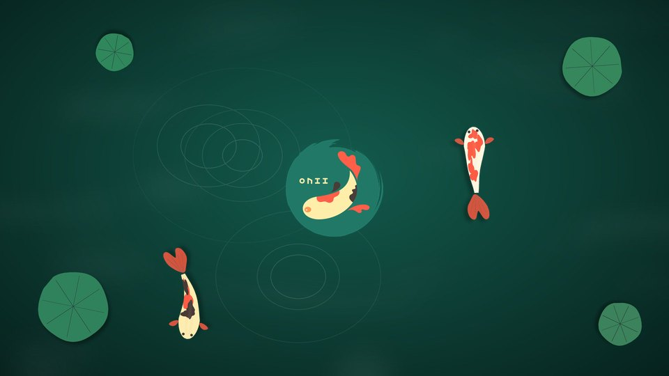

# OweeKoi

Tema para **KDE Plasma 6**: estilo oscuro tipo macOS, kois, un **protector de pantalla animado**
y ajustes de energía y rendimiento para **portátiles y PCs**. Se instala con un solo comando
y se puede deshacer.


## Qué incluye

| | |
|---|---|
| **Fondos** | 4 fondos de 2560×1440 con kois: *Estanque*, *Oscuro*, *Tres kois* y *Logo* |
| **Protector de pantalla** | Fondo animado «Owee Koi» para la pantalla de bloqueo: tres kois nadando, con casi nada de consumo (los peces son imágenes que mueve la tarjeta gráfica) |
| **Pantalla de inicio** | Splash animado: tu logo en el centro y dos kois nadando a su alrededor |
| **Estilo** | [WhiteSur](https://github.com/vinceliuice/WhiteSur-kde) oscuro (tema global, iconos y cursor), dock flotante inferior que se oculta solo, fuente Inter |
| **Iconos** | Tema `OweeLogo`: pone el logo de Owee donde Plasma muestra el logo de la distribución |
| **Energía** | Perfil `laptop` o `pc`; el protector sale a los 5 min y la pantalla se apaga después |
| **Rendimiento** | Desactiva el indexador de archivos Baloo (opcional) |
| **Sistema** *(opcional, con sudo)* | Arranque directo sin menú de GRUB tras un apagado forzado, TRIM, no esperar la red al arrancar, logo en la pantalla de arranque (Plymouth) |

| Pantalla de inicio | Fondo «Tres kois» |
|---|---|
|  |  |

## Requisitos

- **KDE Plasma 6** (probado en KDE neon con Plasma 6.8 y sesión Wayland).
- `git` y conexión a internet, para descargar WhiteSur (se puede evitar con `--sin-whitesur`).
- Para el modo `--sistema`: un sistema basado en Debian/Ubuntu/neon con GRUB y Plymouth.
  En otras distribuciones cada paso se omite solo si no puede aplicarse.

## Instalación

```bash
git clone https://github.com/oweeme/oweekoi.git
cd oweekoi
./install.sh
```

El instalador detecta si tu equipo tiene batería y elige el perfil `laptop` o `pc`.
Antes de cambiar nada guarda tu configuración en `~/.local/share/oweekoi/respaldo-<fecha>`.
Al terminar, **cierra sesión y vuelve a entrar**.

### Opciones

```text
--perfil laptop|pc|auto   Ajustes de energía (por defecto auto: laptop si hay batería)
--sin-whitesur            No descarga WhiteSur (queda Breeze oscuro + iconos propios)
--sin-dock                No crea el dock flotante inferior
--sin-energia             No toca la configuración de energía
--mantener-baloo          No desactiva el indexador de archivos
--solo-archivos           Solo copia archivos; no cambia la configuración de Plasma
--sistema                 Además aplica los ajustes de sistema (pide sudo)
```

### Ajustes de sistema (opcional)

```bash
./install.sh --sistema
```

Ejecuta `lib/sistema.sh` con `sudo`. Cada paso se omite solo si tu sistema no lo admite y
**no borra paquetes**:

1. GRUB sin esperar el menú tras un apagado forzado (`GRUB_RECORDFAIL_TIMEOUT=0`).
2. `fstrim.timer` activado (TRIM semanal del SSD).
3. `NetworkManager-wait-online` desactivado (el escritorio llega unos 6 s antes).
4. Fuente Inter (`apt`).
5. Portátiles Intel: `thermald`.
6. Pantalla de arranque con tu logo: crea un tema Plymouth propio, `oweekoi`, copia de breeze,
   sin tocar el original. Para volver: `sudo update-alternatives --set default.plymouth /usr/share/plymouth/themes/breeze/breeze.plymouth && sudo update-initramfs -u`.

## Perfiles de energía

| | Portátil con batería | Enchufado / PC |
|---|---|---|
| Se bloquea y salen los kois | 5 min | 5 min |
| Se atenúa la pantalla | min 9 | min 14 |
| Se apaga la pantalla | min 10 | min 15 |
| Suspende | min 15 | portátil: min 30 · PC: min 60 |
| Perfil de energía | ahorro | equilibrado |

Con batería baja, el portátil atenúa a 1 min, apaga la pantalla a los 2 y suspende a los 5.

## Desinstalar

```bash
./uninstall.sh
```

Restaura el último respaldo de configuración y borra los archivos de OweeKoi. No desinstala
WhiteSur ni lo que haya instalado el modo `--sistema`. El dock se quita con clic derecho sobre él →
*Editar panel* → *Eliminar panel*.

## Cómo está hecho

- **Protector de pantalla**: Plasma no trae uno clásico; OweeKoi es un *fondo de pantalla* en QML
  (`tema/plasma/wallpapers/org.owee.koi`) usado como fondo del bloqueo. Cada pez es una hoja de 16
  fotogramas con la ondulación ya dibujada; en pantalla solo se mueven con transformaciones de GPU.
- **Pantalla de inicio**: paquete *look-and-feel* con solo el splash
  (`tema/plasma/look-and-feel/org.owee.koi`).
- **WhiteSur** no se redistribuye aquí: se descarga de su repositorio en una versión fija
  (ver `install.sh`).

## Créditos y licencia

- Arte y código: Owee · <https://oweeme.com>
- [WhiteSur](https://github.com/vinceliuice/WhiteSur-kde) (KDE, iconos y cursores) es de
  [vinceliuice](https://github.com/vinceliuice), bajo su propia licencia.
- Licencia de este repositorio: **GPL-3.0** (ver `LICENSE`).

---

## English

**OweeKoi** is a theme for **KDE Plasma 6**: macOS-like dark style, koi wallpapers, an animated
koi screensaver (lock screen), an animated splash screen and power/performance presets for laptops
and desktop PCs.

```bash
git clone https://github.com/oweeme/oweekoi.git && cd oweekoi && ./install.sh
```

Use `--perfil laptop|pc`, `--sin-whitesur`, `--sin-dock`, `--sin-energia`, `--mantener-baloo`,
`--solo-archivos` or `--sistema` (sudo: skip the GRUB menu after a hard power-off, TRIM, boot logo).
Your previous settings are backed up first and `./uninstall.sh` restores them. Licensed GPL-3.0.
